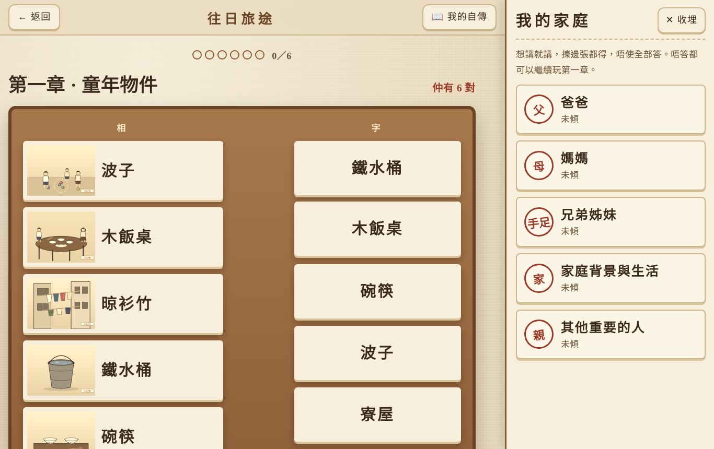
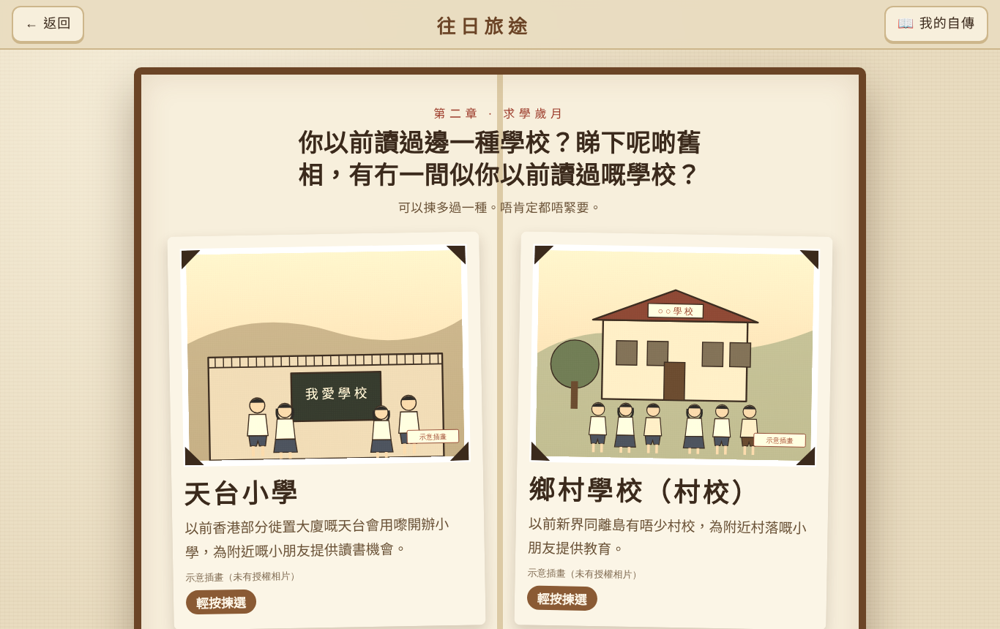
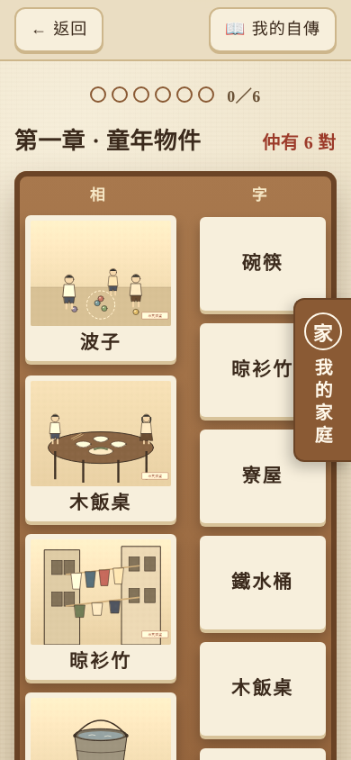

# 往日旅途 · 香港長者懷舊回憶自傳遊戲

透過懷舊物件配對、回憶分享同 AI 整理，幫香港長者一步步記錄自己嘅人生故事。
五章：童年時光、求學歲月、踏入社會、期間大事件、晚年生活。按**出生組（1940–1949／1950–1959／1960–1966）**同**本人確認嘅經歷**揀配對物件，共 92 筆分齡及個人經歷素材。

**[▶ 開啟遊戲](https://wangri-lvtu-hk.visionlink-workspace.workers.dev/)** · 免費、香港可以直接開、唔使登入 · 電腦、平板、手機都用得
（網站由 Cloudflare Workers 提供，網址：https://wangri-lvtu-hk.visionlink-workspace.workers.dev/ ）

| 封面 | 第一章 · 配對 + 我的家庭 |
|---|---|
|  |  |
| **第二章 · 學校類型相簿** | **手機版** |
|  |  |

## 使用網站

1. 輕按封面 → 輸入歲數（可以自己改出世年份）。支援 **1940–1949、1950–1959、1960–1966 年出世** 三個組別，內容各有唔同；範圍以外要本人揀先試玩。
2. **第一章 · 童年時光**：左右兩邊都係詞語，點兩個一樣嘅詞語配對（每次打開次序都會打亂）；配對成功先彈出有相片嘅回憶卡，可以打字或者用廣東話講。右邊「我的家庭」可以隨時打開，唔講都得。
3. **第二章 · 求學歲月**：先答「你細個有冇返過學呀？」（A／B／C／不記得），按答案去學校類型相簿、可選填年份，或者生活與學習技能配對。
4. **第三章 · 踏入社會**：開頭可以揀八類經歷（返學、學師、工場、家務、小生意、鄉郊水上、離鄉多地、朋友社區）同生活地點——可以多選、可以全部唔揀、之後可以改。揀咗「有」先會加入嗰類物件。
5. **第四章 · 期間大事件**、**第五章 · 晚年生活**：用同一種配對同回憶卡。
6. 回憶卡：「有，我想分享」「冇呢段經歷」「冇乜印象」「跳過」（第一、二章維持原有三個按鈕）；分享後可以選擇再講多啲。
7. AI 只根據長者真正講過嘅內容整理每一章故事，可以修改、用廣東話讀出、保存到「我的人生自傳」，亦可以「下載自傳文字檔」留底。

回憶紀錄只存喺**每部裝置自己嘅瀏覽器**，唔會上傳；舊紀錄會自動升級，唔會清空。開啟 AI 時，長者寫嘅內容會經 Cloudflare 送去 Google Gemini 整理。

素材接入、選題規則同去重方法見 [`docs/MATERIALS.md`](docs/MATERIALS.md)。

## 圖片同版權

遊戲使用香港政府網站（政府檔案處、房屋署等）可查閱嘅歷史相片，回憶卡顯示每張相嘅年份、來源同檔案編號。
相片年份只係同類物件參考，唔等於長者經歷嘅年份。來源同權利狀態見 [`docs/photo-sources.md`](docs/photo-sources.md)；
刪走某張相片，遊戲會自動改用同名嘅「示意插畫」。

## 部署（Cloudflare Workers，免費 workers.dev 網域）

**推薦：連 GitHub 自動部署** —— Cloudflare → Workers & Pages → Create → Import a repository → 揀呢個 repo：
- Build command：`npm run build:cloudflare`
- Deploy command：`npx wrangler deploy`
- AI 預設關閉（`AI_ENABLED = "false"`），遊戲照常玩得。要開：加 Secret `GEMINI_API_KEY`，再將 `wrangler.toml` 嘅 `AI_ENABLED` 改做 `"true"`

之後每次推上 `main`，網站就會自動更新。其他方法（Windows 雙擊 `deploy-windows.bat`、手動指令）見 [`DEPLOY.md`](DEPLOY.md)。

---

## 一、安裝同執行

需要先安裝 [Node.js](https://nodejs.org/)（18 或以上）。

```bash
npm install        # 第一次先要做
npm run dev        # 開發模式，打開畫面顯示嘅網址（通常係 http://localhost:5173）
```

其他指令：

| 指令 | 用途 |
|---|---|
| `npm run build` | 打包成一般網站，結果喺 `dist/`，可以放上任何靜態網站寄存（例如 GitHub Pages） |
| `npm run build:single` | 打包成**單一 HTML 檔**（`dist-single/index.html`），圖片已內嵌，直接雙擊就可以喺瀏覽器玩 |
| `npm run preview` | 預覽 `npm run build` 嘅結果 |
| `npm run ai-server` | 可選：啟動本機 AI 伺服器（見第五節） |

---

## 二、遊戲流程

1. **封面**：成個封面係一個大按鈕，輕按「開啟回憶之旅」。
2. **問歲數**：長者輸入今年幾多歲，系統推算出生年代（例如 81 歲 → 約 1945 年出世 → 1940 年代）。
   試玩版只完成 1940 年代；其他年代會提示製作中，並可以先試玩 1940 年代。
3. **進入童年封面**：顯示「第一章 · 童年時光」封面，輕按進入。
4. **同名配對**：左邊係物件圖片同名稱，右邊係打亂次序嘅同名文字（例如圖片「木飯桌」配文字「木飯桌」）。點兩邊同名嘅，會連線然後消失。
   - 六組物件：波子、木飯桌、晾衫竹、鐵水桶、碗筷、寮屋（只係回憶線索，唔代表長者一定用過或者住過）。
   - 配錯會輕輕搖一搖，提示「再試一次」，**唔扣分、冇倒數**。
   - 點咗一張相之後會出現「唔熟悉，跳過呢張」，唔認得嘅物件可以直接跳過。
   - **「我的家庭」**：配對畫面右邊有固定入口（桌面＝右側邊欄，唔遮住配對；手機／平板＝由右邊拉出嘅抽屜）。
     五張卡：爸爸、媽媽、兄弟姊妹、家庭背景與生活、其他重要的人。每張有「有回憶，我想分享」「沒有相關經歷」「不想回答／跳過」；
     分享完 AI 會揀一條追問（可以答、換另一條，或者唔答）。揀邊張都得，**唔係完成第一章嘅必要條件**，亦唔會要求長者揀「貧窮／富裕」之類嘅階級。
   - 長者分享咗家庭資料之後，AI 會按資料調整物件問題（例如講過爸爸做木工，配對「木飯桌」時會問「張飯桌係咪爸爸自己整㗎？」），但唔會當咗係事實；冇分享就用一般問題。
5. **回憶卡**：每配對成功就彈出回憶卡。
   - 上半：物件大圖、名稱、簡短介紹
   - 下半：回憶問題 + 三個大按鈕：「有回憶，我想分享」「冇乜印象」「跳過」
   - 分享方式：打字，或者按「🎤 用廣東話講」語音轉文字；可以檢查同修改，再按「保存回憶」
   - 揀「冇乜印象」或「跳過」就直接返回配對，**唔會虛構回憶**
6. **最後一張回憶卡**：上面係問號，問「仲有冇邊啲童年趣事／回憶，係你特別難忘嘅呢？」
7. **恭喜完成**：「恭喜你完成童年時光嘅探索！」→「整理我的童年故事」
8. **童年自傳草稿**：AI 只根據長者真正分享嘅內容，整理成第一人稱嘅故事（家庭與成長背景 → 居住環境 → 玩樂與朋友 → 家庭生活 → 難忘嘅人和事）。
   「我的家庭」有分享先會寫入；冇分享就唔會寫爸爸、媽媽、兄弟姊妹。
   - 可以自己修改、重新整理、按「🔊 用廣東話讀出嚟」
   - 如果全部都跳過，會顯示「暫時未收集到足夠回憶」，唔會生成虛構自傳
9. **第二章「求學歲月」**（見下面第三節）
10. **人生自傳收藏頁**：相簿風格，第一章顯示童年故事同所有回憶卡（可修改、刪除、補充）；
   第二章顯示所揀路線、回憶卡、離校之後嘅訪談同 AI 故事；第三章「踏入社會」已預留位置，顯示「即將推出」。

所有紀錄儲存喺**呢部裝置嘅瀏覽器**（localStorage）。清除瀏覽器資料或者換電腦就會唔見。

---

## 二之二、第二章「求學歲月」

流程：**求學章節 → A/B/C 路線 → 學校類型（A/B）→ 可選填年份 → 圖片名稱配對 → 回憶卡 →（B）離校訪談 → AI 整理自傳**

1. 先問「你細個有冇返過學呀？」，四個答案：
   - A：有接受過小學教育　B：有返過學，但中途離校　C：沒有接受過正規小學教育　不記得／跳過
2. **A／B → 學校類型選擇**（似一本打開咗嘅相簿）：
   - 兩張大照片卡：天台小學、鄉村學校（村校）
   - 其他選項：幼兒學校、其他學校（官立、津貼或私立）、讀過不止一種學校、不記得／不清楚
   - 可以揀多過一種；揀咗多種會多一張「轉校」回憶卡
3. **可選填年份**：開始就讀年份、離校年份、或者揀大概年代，仲可以填學校名稱。全部可以跳過。
   年份同出世年份對唔上只會溫和提示，唔會阻止繼續。可以「返回修改學校選項」。
4. **圖片名稱配對**：左邊係相同名稱，右邊係打亂次序嘅相同名稱文字。
   - 第一回：你揀咗嘅學校類型（＋轉校）
   - 第二回「課室入面嘅嘢」：成績表、木課桌、課本、練習簿、校鐘、學校校門
   - 第三回「讀書以外嘅日子」：穿膠花、剪線頭、擦鞋仔、賣報紙、雜貨店、鐵飯盒
   - 唔熟悉嘅圖片可以跳過
5. **回憶卡**：有 AI 時，問題會按學校類型同年份調整；冇 AI 就用預設問題（例如天台小學：「你以前返學係咪要行樓梯上天台？嗰陣課室環境係點樣？」）。
6. **B 路線**配對完會再傾三條：離校原因、家庭生活、之後學嘢或者做嘢（每條都可以跳過）。
7. **C／不記得**：直接去「生活與學習技能」配對，唔使揀學校，分三回：
   - 幫補家計：穿膠花、剪線頭、擦鞋箱、報紙、雜貨店
   - 生活手藝：鐵飯盒、磅秤、針線盒、木工工具、漁網
   - 自己學識嘅嘢：舊報紙、算盤、毛筆、收音機
8. AI 整理「我的求學歲月」：會用學校類型、年份、學校名同長者分享嘅內容，唔會虛構。
9. 喺「我的自傳 → 第二章」可以睇同修改學校資料、回憶同故事。

**圖片來源同版權狀況**：見 `docs/photo-sources.md`（每張相嘅名稱、年份、學校類型、連結、來源機構、使用限制）。

---

## 三、圖片資料夾（換成你自己嘅歷史圖片）

```
src/assets/images/
├── covers/
│   ├── cover-photo.jpg      ← 遊戲封面中間嘅相
│   ├── chapter1-photo.jpg   ← 「童年時光」封面嘅相
│   ├── cover.jpg            ← （可選）你自己設計好嘅完整遊戲封面
│   └── chapter1-cover.jpg   ← （可選）你自己設計好嘅完整「進入童年」封面
└── childhood/
    ├── hopscotch.jpg        跳飛機
    ├── kite.svg             風箏（示意插畫，建議換成真實照片）
    ├── spinning-top.jpg     打陀螺
    ├── marbles.jpg          彈波子
    ├── squatter-hut.jpg     寮屋
    ├── tong-lau.jpg         唐樓
    ├── stove.jpg            煤油爐／炭爐
    ├── laundry-pole.jpg     晾衫竹
    ├── dining-table.jpg     木飯桌、碗筷
    ├── bowls-chopsticks.jpg （後備：碗筷特寫）
    └── going-out.jpg        出街
src/assets/images/learning/      第二章（來源詳見 docs/photo-sources.md）
    ├── rooftop-school-hillside.jpg  天台小學（揀選卡）
    ├── village-school-zongfu.jpg    村校（揀選卡）
    ├── kindergarten-1964.jpg        幼兒學校
    ├── report-card.jpg              成績表
    ├── wooden-desks.jpg             木課桌
    ├── textbooks-1967.jpg           課本
    ├── exercise-book.svg            練習簿（示意插畫）
    ├── transfer.svg                 轉校（示意插畫）
    ├── rooftop-school.jpg   天台學校（政府檔案處 HKRS365，1966）
    ├── village-school.svg   村校（示意插畫）
    ├── lesson.jpg           上堂（政府檔案處 HKRS365，1964）
    ├── teacher.jpg          老師（政府檔案處 HKRS365，1964）
    ├── classmates.jpg       同學（政府檔案處 HKRS365，1966）
    ├── dictation.svg        默書（示意插畫）
    ├── schoolbag.svg        書包（示意插畫）
    ├── literacy.svg         識字（示意插畫）
    ├── siblings.svg         湊細佬妹（示意插畫）
    ├── carry-water.svg      擔水（示意插畫）
    ├── apprentice.jpg       學師（政府檔案處 HKRS156-3-24，1955）
    └── early-work.jpg       幫補家計（政府檔案處 HKRS156-3-24，1955）
（煮飯沿用 childhood/stove.jpg；第二章封面相係 covers/chapter2-photo.jpg，亦可放 covers/chapter2-cover.jpg 用你自己嘅封面）
```

- **換物件圖**：用同一個檔名覆蓋就得。如果改咗檔名或者副檔名（例如 `kite.jpg`），記得改
  `src/data/childhood1940.js` 頂部嘅 `import`。
- **用你自己設計嘅封面**：將圖片命名為 `cover.jpg` 或 `chapter1-cover.jpg`（亦可以用 `.png`），
  放入 `covers/`。系統會自動用你嘅圖片做成可以點擊嘅大按鈕，唔使改程式。
- 建議相片闊度約 1000px、每張 300KB 以內，載入會快啲。
- **版權**：請只使用你有權使用嘅相片（例如自己家庭相、已取得授權或者版權已屆滿嘅相片）。

---

## 四、改詞語同問題

全部喺 `src/data/childhood1940.js`：

```js
{ id: 'hopscotch', round: 'games', name: '跳飛機', image: hopscotch,
  intro: '以前細路喺街邊、天台用粉筆畫格仔……',
  question: '你以前會唔會同街坊小朋友喺地下畫格仔玩？' },
```

- `round`：放喺邊一回（`games` 童年遊戲／`home` 居住同屋企生活），亦可以喺 `rounds` 加新回合
- `finalQuestion`：最後一張回憶卡嘅問題
- 章節結構喺 `src/data/chapters.js`；之後加第二章「求學歲月」時，照樣新增一個資料檔即可。

---

## 五、AI 功能（Google Gemini）

AI 負責三樣嘢：整理自傳、按學校類型調整回憶卡問題、路線 B 嘅離校訪談。`src/lib/ai.js` 會按以下次序揀方法：

1. **喺 claude.ai 嘅 Artifact 入面打開**：用 Claude。
2. **公開網站（Cloudflare）**：網頁呼叫自己網站嘅 `/api/ai`，由 Cloudflare Worker（`worker/index.js`）用你嘅 **Gemini API key** 呼叫 Google Gemini。API key 只留喺 Cloudflare，唔會出現喺網頁。
3. **兩樣都用唔到**：唔用 AI，只將長者講過嘅說話按次序排好，畫面會註明；遊戲唔會卡住。

本機開發：
```bash
GEMINI_API_KEY=你的key npm run ai-server
# 另一個視窗：
VITE_AI_ENDPOINT=http://127.0.0.1:8787/api/ai npm run dev
```

提示（prompt）已規定：只用長者真正分享嘅內容、唔可以捏造人物、地點、年份或者經歷、冇分享嘅物件唔寫入故事。
模型預設 `gemini-3.6-flash`，可以喺 `wrangler.toml` 嘅 `GEMINI_MODEL` 改。

---

## 六、語音

- **語音輸入**：用瀏覽器內建 Web Speech API（語言設為 `yue-Hant-HK`），Chrome／Edge 支援較好，需要上網同咪高峰權限。
  瀏覽器唔支援時，咪高峰按鈕會自動隱藏，只用打字。語音只會轉成文字，**唔會保存錄音**。
- **廣東話朗讀**：用瀏覽器內建語音（`zh-HK`）。如果裝置冇廣東話語音，會提示可能唔係廣東話。
  Windows 可以喺「設定 → 時間與語言 → 語音」加入「中文（香港）」語音。

---

## 七、長者友善設計

主要文字 20px 以上、按鈕最少 48px 高（主要按鈕 56–66px）、冇倒數、配錯唔罰、回憶卡有返回同跳過、
頂部長期有「返回」同「我的自傳」、重要操作有成功提示、唔會自動播放聲音、回憶可以修改同刪除、
刪除同清除紀錄要按兩次確認。

---

## 八、程式結構

```
src/
├── App.jsx                 畫面流程同遊戲狀態
├── styles.css              懷舊相簿風格
├── data/
│   ├── chapters.js         章節同年代設定
│   ├── childhood1940.js    第一章詞語、介紹、問題、圖片
│   └── learning1940.js     第二章路線、學校類型、問題、訪談、圖片
├── lib/
│   ├── storage.js          儲存紀錄（localStorage）
│   ├── ai.js               AI 整理故事
│   └── speech.js           語音輸入同朗讀
└── components/
    ├── Screens.jsx         封面、問歲數、章節封面、恭喜頁
    ├── MatchGame.jsx       相同名稱配對
    ├── MemoryCard.jsx      回憶卡、最後問號卡
    ├── MemoryEditor.jsx    文字＋語音輸入
    ├── Learning.jsx        第二章：問有冇返學、路線介紹、離校訪談
    ├── School.jsx          第二章：學校類型相簿、可選填年份
    ├── PairMatch.jsx       第二章：左相右字圖片名稱配對
    ├── StoryPage.jsx       自傳草稿、朗讀
    └── Album.jsx           人生自傳收藏頁
server/ai-server.mjs        本機 AI 伺服器（Gemini）
worker/index.js             Cloudflare Worker：網站 + /api/ai
worker/gemini.js            呼叫 Gemini API
wrangler.toml               Cloudflare 部署設定
```

---

## 九、放上 Cloudflare（任何地方、包括香港都打得開）

### 方法一：直接上載（最簡單，冇 AI）
1. 開一個免費 Cloudflare 帳戶，登入 https://dash.cloudflare.com
2. 左邊揀 **Workers & Pages** → **Create** → **Pages** → **Upload assets**
3. 改專案名（例如 `wangri-lvtu`）→ **Create project**
4. 解壓 `wangri-lvtu-site.zip`，把成個資料夾（入面有 `index.html` 同 `assets`）拖入去 → **Deploy site**
5. 網址：`https://wangri-lvtu.pages.dev`

呢個方法冇 AI：遊戲會自動將長者講過嘅說話按次序排好，其他功能全部正常。

### 最簡單：Windows 雙擊 `deploy-windows.bat`
會自動安裝、打開瀏覽器俾你自己登入 Cloudflare、部署，最後顯示 `https://wangri-lvtu-hk.<你嘅子網域>.workers.dev`。
workers.dev 係免費網域，香港可以直接打開，唔使登入任何嘢。

### 方法二：連 Gemini AI 一齊開（要用終端機，一次過搞掂）
1. 去 Google AI Studio（https://aistudio.google.com）攞一條 **Gemini API key**。
   ⚠️ Google 唔開放 Gemini API 俾香港：喺香港要經支援地區（例如美國、日本、新加坡）嘅網絡先申請到。
2. 喺專案資料夾：
   ```bash
   npm install
   npx wrangler login                    # 第一次會開瀏覽器登入 Cloudflare
   npx wrangler secret put GEMINI_API_KEY   # 貼上你條 key（唔會顯示出嚟）
   # 再將 wrangler.toml 嘅 AI_ENABLED 改做 "true"
   npm run deploy                        # 打包網站 + 部署 Worker
   ```
3. 網址：`https://wangri-lvtu-hk.<你嘅帳戶子網域>.workers.dev`（終端機會顯示），之後可以喺 Cloudflare 綁定自己嘅網域。

**香港用 AI 要留意**：Gemini API 會拒絕由香港 IP 發出嘅請求。如果開咗 AI 之後喺香港用唔到（`/health` 正常但故事變成原話排列），可以喺 `wrangler.toml` 加 `[placement] region = "gcp:us-central1"`，叫 Cloudflare 喺美國執行 `/api/ai`。

**測試**：`npm test`（Worker API 驗證、冇 AI 時嘅原話整理、自傳匯出）。

### 要留意
- **語音輸入**喺公開網站用 Chrome／Edge 就得（要允許咪高峰）；**廣東話朗讀**視乎裝置有冇裝香港中文語音。
- 回憶紀錄只存喺**每部裝置嘅瀏覽器**，唔會上傳。但開啟 AI 時，長者寫嘅內容會經 Cloudflare 送去 Google Gemini 處理，活動前要向長者說明。
- **版權**：公開網站任何人都睇到。`docs/photo-sources.md` 標示 ⚠️ 嘅相、同埋政府檔案處／教大嘅相，公開前要先取得授權，或者換成示意圖。
